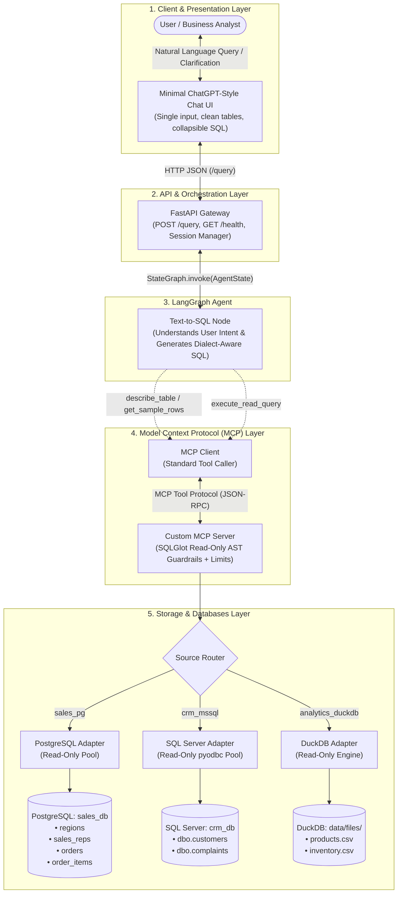

# Multi-Source Agentic Text-to-SQL with MCP

## 1. Project Purpose

An agentic data analyst that converts natural-language questions into safe, dialect-specific read-only SQL queries across multiple databases (`PostgreSQL`, `SQL Server`, and `DuckDB`) using **LangGraph** and the **Model Context Protocol (MCP)**.

Instead of connecting the agent directly to database drivers, all schema discovery and query execution pass through a custom MCP server with strict AST read-only validation.

---

## 2. Architecture

### System Architecture Diagram



### Layer-by-Layer Architecture Breakdown

| Layer | Component | Technology / Implementation | Core Responsibility |
| :--- | :--- | :--- | :--- |
| **1. Presentation** | Modern Chat UI | HTML5, CSS3, Vanilla JS | Minimal ChatGPT-style interface with a single auto-centering bottom composer, response streaming, collapsible SQL preview, and clean tabular rendering. |
| **2. API Gateway** | REST API & Sessions | FastAPI, Uvicorn, Pydantic | Exposes `/query` and `/health`, manages conversation session memory (`thread_id`), and bridges HTTP clients to the agent graph. |
| **3. Agent Core** | LangGraph StateGraph | LangGraph, Python 3.11 | Focused Text-to-SQL Node responsible for understanding user queries, checking for ambiguity, and generating dialect-aware SQL across target data sources. |
| **4. MCP Layer** | Custom MCP Server & Client | Model Context Protocol SDK, SQLGlot | Abstracts database drivers behind 6 standardized tools. Enforces AST read-only safety validation (`validate_read_only_sql`), row limits (`apply_query_limit`), and query execution timeouts. |
| **5. Storage Layer** | Heterogeneous Databases | PostgreSQL 16, MS SQL Server, DuckDB | Stores business data across distributed domains: operational sales in PostgreSQL, customer support in SQL Server, and catalog/inventory in analytical CSV files. |

---

## 3. Supported Data Sources

> [!NOTE]
> For complete table schemas, data types, sample data rows, cross-source key diagrams, and sample natural language queries with expected answers, see [DATA_README.md](DATA_README.md).

| Source ID | Engine | Domain & Tables | Shared Keys |
| :--- | :--- | :--- | :--- |
| `sales_pg` | PostgreSQL | `regions`, `orders`, `order_items`, `sales_reps` | `region_id`, `customer_id`, `product_id` |
| `crm_mssql` | SQL Server | `dbo.customers`, `dbo.complaints` | `customer_id`, `region_id`, `product_id` |
| `analytics_duckdb` | DuckDB (CSV) | `products` (`products.csv`), `inventory` (`inventory.csv`) | `product_id` |

---

## 4. Main Workflow

1. **User Query Input:** The user submits a natural-language question or follow-up in the chat UI.
2. **Text-to-SQL Generation (Agent):** The Text-to-SQL node analyzes the query, checks for ambiguity, and generates dialect-aware read-only SQL matching the target data sources (PostgreSQL, SQL Server, DuckDB).
3. **MCP Query Execution:** The generated SQL queries are executed via the MCP Client through the custom MCP Server with AST safety guardrails and row caps.
4. **Data Aggregation & Grounded Answer:** Returned records are merged across sources, formatted into clean tabular data, and presented to the user with a collapsible "View generated SQL" preview.


---

## 5. MCP Tools

The custom MCP server exposes 6 standardized tools via the official MCP SDK:

- `list_data_sources()`
- `list_tables(source)`
- `describe_table(source, table)`
- `get_relationships(source)`
- `get_sample_rows(source, table, limit)`
- `execute_read_query(source, validated_sql)`

---

## 6. Safety Mechanism

1. **SQLGlot AST Validation:** Rejects any statement that is not a single `SELECT` query (`INSERT`, `UPDATE`, `DELETE`, `DROP`, `ALTER`, `TRUNCATE`, and multi-statement queries are blocked).
2. **Automatic Row Limits & Timeouts:** Enforces row caps (`LIMIT` / `TOP`) and query execution timeouts.
3. **Read-Only Database Credentials:** Database adapters connect using restricted `SELECT`-only users (`readonly_pg_user`, `readonly_mssql_user`) and read-only DuckDB views.

---

## 7. Setup Instructions

```bash
# 1. Create and activate virtual environment
python -m venv .venv
.\.venv\Scripts\activate

# 2. Install dependencies
pip install -r requirements.txt

# 3. Copy environment configuration
copy .env.example .env
```

---

## 8. How to Run

```bash
# Start FastAPI server and Chat UI on http://localhost:8000
.\.venv\Scripts\python.exe -m uvicorn src.api.app:app --host 0.0.0.0 --port 8000

# Run the automated test suite
.\.venv\Scripts\pytest.exe -v tests/
```

Open **`http://localhost:8000`** in your browser to use the chat interface.

---

## 9. Example Queries

- **Single Attribute Lookup (DuckDB):**
  `"What is the cost price of Database Replica Agent?"` → `1,100`
- **Multi-Attribute Arithmetic Difference (DuckDB):**
  `"What is the difference between the list price and cost price of Database Replica Agent?"` → `list_price = 2,400`, `cost_price = 1,100`, `difference = 1,300`
- **Ungrouped Scalar Total (PostgreSQL):**
  `"What was the total completed revenue in Q4-2025?"` → `1,466,000`
- **Ungrouped Scalar Count (SQL Server):**
  `"How many complaints were recorded in Q4-2025?"` → `40`
- **Grouped Regional Breakdown (PostgreSQL):**
  `"Show completed revenue by region in Q4-2025."` → `4 regional rows`
- **Cross-Source Entity Lookup (PostgreSQL + SQL Server):**
  `"Who placed the highest-value completed order in Q4-2025, and which company do they belong to?"` → `Marcus Wright of Bayview Data Lab (135,000)`
- **Cross-Source Regional Aggregation (PostgreSQL + SQL Server):**
  `"Compare Q4-2025 revenue and complaint counts by region."` → `4 regions with total_revenue and complaint_count`
